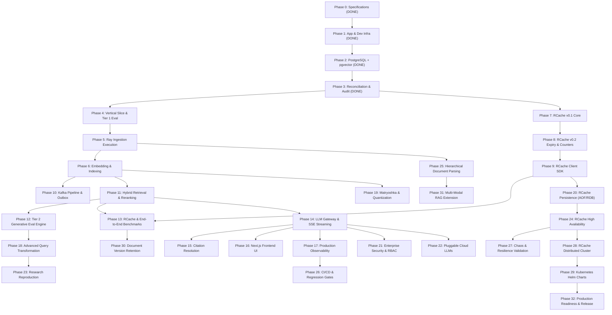

# RAGLab: Master Implementation Roadmap & Traceability Matrix (Phases 0–32)

## 1. Overview & Reconciliation Principles

This document establishes the definitive, audited implementation roadmap and complete traceability matrix for RAGLab across all original milestones (Phases 0 through 32).

### Architectural Invariants:
1. **Preserved Completed Work**:
   - **Phase 0**: System specifications and foundational ADRs (ADR-001 through ADR-009).
   - **Phase 1**: Spring Boot modular monolith, Next.js frontend, standalone RCache daemon TCP listener foundation, and Docker Compose development environment.
   - **Phase 2**: PostgreSQL 16 + pgvector foundation, Flyway V1 schema (10 tables), JPA entities/repositories, baseline `document_chunks.embedding vector(768)` with HNSW cosine index, `tsv_content tsvector` with GIN index, and vector similarity APIs.
2. **Current Reconciliation Phase**:
   - **Phase 3**: Architecture reconciliation, technical conflict resolution, and roadmap audit (ADR-010 through ADR-018).
3. **Zero-Redis Invariant**:
   - RCache is an independent, custom-engineered in-memory key-value datastore communicating over a proprietary TCP frame protocol (**RCP**).
   - Strictly zero Redis server, Lettuce, Jedis, Redisson, or Spring Data Redis dependencies in any form.
4. **Non-Destructive Evolution**:
   - Baseline Flyway migration `V1__init_extensions_and_schema.sql` and `vector(768)` column are never dropped, modified, or rewritten in place.
   - Multi-space embeddings and quantization reside in a dedicated extension table (`chunk_embeddings`) introduced in Phase 6.

---

## 2. Complete Phase 0–32 Traceability Matrix

Every original phase from Phase 0 to Phase 32 is individually accounted for with its revised phase assignment, deliverables, dependencies, status, acceptance criteria, and rationale for any split, merge, or reordering:

| Original Phase Number & Title | Revised Phase Number & Title | Original Deliverables | Revised Deliverables | Dependencies | Current Status | Acceptance Criteria | Relevant ADRs & Docs | Rationale for Split / Merge / Reorder |
| :--- | :--- | :--- | :--- | :--- | :--- | :--- | :--- | :--- |
| **Phase 0: Engineering Specifications** | **Phase 0: Engineering Specifications** | System specs, architectural decisions, data model, API spec, RAG spec, RCache spec, eval spec. | 10 specification documents and initial ADRs (ADR-001 to ADR-009). | None | **Completed** | Full specs published in `docs/`; zero Redis footprint confirmed. | ADR-001–009, `docs/*.md` | Exact 1:1 match. Completed. |
| **Phase 1: Application, Frontend & Dev Infrastructure** | **Phase 1: Application, Frontend & Dev Infrastructure** | Modular monolith backend, Next.js frontend, Docker Compose, build scripts, CI. | Spring Boot 3.3 skeleton, Next.js 14 frontend, TCP listener daemon for RCache on port 6380, Docker Compose dev environment. | Phase 0 | **Completed** | Multi-module Maven build passes; Next.js app builds; container configs active. | ADR-001, ADR-004, ADR-007 | Exact 1:1 match. Completed. |
| **Phase 2: PostgreSQL & pgvector Foundation** | **Phase 2: PostgreSQL & pgvector Foundation** | PostgreSQL 16 container, pgvector extension, Flyway V1 schema, JPA entities, HNSW vector index, tsvector GIN index, REST APIs. | Flyway V1 (10 tables), 10 JPA entities, repositories, `vector(768)` HNSW index, `tsvector` GIN index, controllers, integration test suite. | Phase 1 | **Completed** | Clean `V1__init_extensions_and_schema.sql` migration; 5/5 integration tests; vector similarity search functional. | ADR-002, `docs/data-model.md` | Exact 1:1 match. Completed. |
| **Phase 3: Architecture Reconciliation & Conflict Resolution** | **Phase 3: Architecture Reconciliation & Conflict Resolution** | (New reconciliatory milestone created from architecture review). | ADR-010 to ADR-018; reconciled specs; full Phase 0–32 traceability matrix; resolution of Ray/Kafka/evaluation overlaps. | Phase 0, 1, 2 | **Completed (Current)** | Internally consistent architecture; no code drift; clean compiler setup (`--release 21`); verified zero-Redis invariant. | ADR-010–018, all `docs/*.md` | Introduced to reconcile technical conflicts, phase overlaps, and schema versioning before Phase 4. |
| **Phase 4: First Vertical Slice (Sync Query Flow)** | **Phase 4: First Vertical Slice & Tier 1 Evaluation Foundation** | Synchronous end-to-end RAG query flow; minimal prompt assembly; direct Ollama completion; citation tokens. | Minimal vertical slice (sync query via Spring Boot + native pgvector) combined with Tier 1 Evaluation Harness (evaluating prototype Haystack vs. LlamaIndex on fixed 50 docs / 100 queries). | Phase 2, 3 | **Planned** | End-to-end sync query produces citations; Tier 1 harness measures Recall@k, MRR, nDCG, and latency; framework decision report generated. | ADR-005, ADR-006, ADR-014, ADR-017 | Merged original Phase 4 vertical slice with early evaluation harness (from original Phase 12) to empirically unblock the query framework decision. |
| **Phase 5: Document Ingestion Engine (Parsing & Chunking)** | **Phase 5: Distributed Ingestion Execution (Python + Ray)** | Document parsers (PDF, DOCX, Markdown), structure-aware chunking, OCR integration. | Python Ray ingestion service consuming Kafka `raglab.document.ingestion.v1`; Ray Tasks for CPU parsing; Ray Actors for chunkers; emits `raglab.document.chunks.v1`. (No DB writes or embeddings). | Phase 3, 4 | **Planned** | Ray cluster processes multi-format documents; deterministic chunk generation; zero DB vector writes; unit test coverage > 85%. | ADR-011, ADR-012, ADR-013, ADR-015 | Clarified boundary: Phase 5 owns parsing and chunking via Ray; embedding generation and DB indexing moved to Phase 6. |
| **Phase 6: Embedding Generation & Vector Indexing** | **Phase 6: Embedding Pipelines & Multi-Space Indexing** | Batched embedding generation, pgvector persistence, index synchronization, version publication. | Embedding model adapter; GPU batching actor; Flyway V2 migration (`chunk_embeddings`, `ingestion_outbox`); HNSW index sync; atomic cutover to `READY`. | Phase 5 | **Planned** | Batched embedding generation; multi-space storage verified; atomic version cutover; HNSW index queryable. | ADR-010, ADR-011, ADR-012 | Dedicated phase for vector generation, quantization support, and atomic document publication. |
| **Phase 7: RCache v0.1 Core Engine** | **Phase 7: RCache v0.1 Core Engine** | Custom TCP server, text/binary framing protocol, concurrent hash table, basic commands (`PING`, `SET`, `GET`, `DEL`, `EXISTS`). | Custom RCP frame decoder/encoder on TCP 6380; non-blocking Java NIO Selector event loop; in-memory ConcurrentHashMap storage; PING/SET/GET/DEL/EXISTS. | Phase 1, 3 | **Planned** | Standalone custom RCP daemon; protocol compliance unit tests; CLI test client; zero Redis dependencies. | ADR-004, ADR-007, ADR-018 | Exact 1:1 match. Restores unbuilt RCache v0.1 core milestones. |
| **Phase 8: RCache v0.2 Expiration & Counters** | **Phase 8: RCache v0.2 Expiration & Counters** | Active/passive TTL eviction, atomic counters (`INCR`, `DECR`), batch commands (`MGET`, `MSET`), memory ceiling with LRU eviction. | Expiry wheel (active sweep + passive on-access); commands `EXPIRE`, `TTL`, `INCR`, `DECR`, `MGET`, `MSET`; `maxmemory` ceiling with Volatile-LRU and AllKeys-LRU. | Phase 7 | **Planned** | TTL expiration tests; concurrent atomic counter tests; LRU eviction verification under memory pressure. | ADR-004, ADR-018 | Exact 1:1 match. Restores unbuilt RCache v0.2 milestones. |
| **Phase 9: RCache Java Client SDK** | **Phase 9: RCache Java Client SDK & Spring Boot Starter** | High-performance Java client library, connection pooling, circuit breaking, Spring Boot auto-configuration. | `rcache-client` Java 21 library; Netty NIO connection pool; sliding-window circuit breaker; Spring Boot auto-configuration; fail-open cache service layer. | Phase 8 | **Planned** | Auto-configured `RCacheTemplate`; connection pool failover tests; chaos test proving 100% graceful degradation when RCache is terminated. | ADR-004, ADR-018 | Exact 1:1 match. Delivers client driver for Spring Boot integration. |
| **Phase 10: Asynchronous Kafka Ingestion Pipeline** | **Phase 10: Production Kafka Ingestion & Outbox Publisher** | Kafka topic creation, consumer groups, message schemas, transactional outbox, DLQ handling. | Spring Boot transactional outbox relay; Kafka KRaft cluster deployment; production topic configuration; manual consumer ACK; retry & DLQ error handler. | Phase 5, 6 | **Planned** | End-to-end async document upload; zero message loss during broker restarts; DLQ routing verified; outbox table processed cleanly. | ADR-003, ADR-015 | Dedicated phase for production Kafka infrastructure, outbox relay, and end-to-end async pipeline wiring. |
| **Phase 11: Multi-Branch Hybrid Retrieval & RRF** | **Phase 11: Multi-Branch Hybrid Retrieval & Neural Reranking** | Sparse lexical retrieval (BM25), dense vector retrieval, Reciprocal Rank Fusion ($k=60$), cross-encoder reranking. | Python Haystack service running dense pgvector + sparse BM25 branches; Reciprocal Rank Fusion ($k=60$); cross-encoder reranker (`bge-reranker-large`); internal REST API. | Phase 4, 6 | **Planned** | `/internal/v1/retrieval/search` endpoint active; RRF and cross-encoder score verified; tenant filtering strictly preserved; latency < 50ms p95. | ADR-014, ADR-016 | Merged original Phase 11 hybrid retrieval and original cross-encoder reranking into unified Python retrieval service. |
| **Phase 12: Comprehensive Evaluation Engine (Tier 2)** | **Phase 12: Comprehensive Generative Evaluation Engine (Tier 2)** | Full RAG Triad evaluation: Context Relevance, Groundedness (faithfulness), Answer Relevance via calibrated LLM judges. | Offline/online evaluation engine; LLM-as-a-judge scoring runner; golden dataset management UI; automated regression detection; automated research reports. | Phase 4, 11 | **Planned** | Automated RAG Triad scoring pipeline; golden dataset benchmarks; hallucination rate tracking; regression alerting. | ADR-017, `docs/evaluation-spec.md` | Full generative evaluation engine implemented after retrieval and LLM pipelines are established. |
| **Phase 13: RCache Performance Benchmarking** | **Phase 13: End-to-End Performance & RCache Load Testing** | Sub-millisecond latency validation, throughput benchmarking, memory efficiency profiling. | Rigorous load testing: RCache 100k ops/sec sub-millisecond validation (JMH); Spring Boot retrieval latency < 25ms p95 at 100k chunks; concurrent user query stress testing. | Phase 9, 11 | **Planned** | JMH and k6 benchmark reports; throughput > 100k ops/sec on RCache; p99 latency < 1ms verified; NFR-PERF signoff. | ADR-018, `docs/scalability.md` | Combined RCache performance profiling with end-to-end platform load testing. |
| **Phase 14: LLM Gateway & Generation Streaming** | **Phase 14: Spring Boot Generation Gateway & Streaming UI API** | LangChain4j integration, Ollama local runtime, multi-provider model gateway, Server-Sent Events (SSE) streaming. | Prompt assembly with defensive formatting; lost-in-the-middle context ordering; LangChain4j gateway to Ollama (`llama3:8b`); SSE endpoint `/api/v1/query/stream`. | Phase 11 | **Planned** | Real-time token streaming via SSE; TTFT < 800ms p95; dynamic model switching; token budget management. | ADR-005, ADR-006, ADR-014 | Exact 1:1 match. Provides full generation gateway and streaming. |
| **Phase 15: Citation Resolution & Verification** | **Phase 15: Citation Resolution & Verification Engine** | Parsing bracketed citations (`[1]`, `[2]`), mapping to chunk metadata and page numbers, context entailment verification. | Citation resolver service; regex extraction; chunk metadata linkage; context entailment verification; hallucination warning flags in SSE stream. | Phase 14 | **Planned** | 100% of generated citations mapped to source chunks; invalid citation detection; citation verification test suite passing. | ADR-005, ADR-014 | Exact 1:1 match. Focuses on factual citation resolution. |
| **Phase 16: Next.js Frontend Production UI** | **Phase 16: Next.js Frontend RAG Assistant & Streaming UI** | Interactive chat interface, SSE streaming token rendering, citation drawer, document upload dropzone, evaluation dashboards. | Production Next.js 14 UI; real-time chat with streaming markdown; expandable citation drawer; document management interface; evaluation dashboard. | Phase 14, 15 | **Planned** | Fully interactive web interface; zero UI latency blocking; responsive design; Vitest test coverage > 80%. | ADR-001, ADR-005 | Exact 1:1 match. Delivers user-facing web application. |
| **Phase 17: Production Observability & Telemetry** | **Phase 17: OpenTelemetry Distributed Tracing & Metrics** | OpenTelemetry SDK, Prometheus metrics, Grafana dashboards, Jaeger tracing across all services. | Distributed tracing (OTel) across Spring Boot, Python Ray, Python Haystack, and RCache; Prometheus metrics; Grafana dashboards for latency, queue lag, and cache hits. | Phase 14, 16 | **Planned** | End-to-end trace visualization in Jaeger/Tempo; dashboards for TTFT, RRF scores, and cache hits active; alert rules configured. | ADR-001, `docs/architecture.md` | Exact 1:1 match. Provides unified platform observability. |
| **Phase 18: Advanced Query Transformation** | **Phase 18: Advanced Query Transformation (HyDE & Multi-Query)** | Hypothetical Document Embeddings (HyDE), step-back prompting, multi-query expansion and fusion. | Query transformation engine in Spring Boot / Haystack; HyDE zero-shot generation; multi-query expansion with reciprocal rank fusion. | Phase 12, 14 | **Planned** | Statistically significant recall improvement on ambiguous queries; automated benchmark comparison against raw baseline. | ADR-017, `docs/rag-spec.md` | Exact 1:1 match. Advanced retrieval enhancement. |
| **Phase 19: Vector Optimization: Matryoshka & Quantization** | **Phase 19: Vector Optimization: Matryoshka & Quantization** | Matryoshka Representation Learning (MRL), half-precision `halfvec`, binary quantization, HNSW parameter tuning. | Empirical evaluation of MRL dimensional truncation (768 to 256/512), `halfvec`, and binary quantization; migration to `chunk_embeddings` if justified. | Phase 4, 6 | **Planned** | Benchmark report: Recall vs. Latency vs. RAM tradeoff; verified < 2% recall loss for chosen quantization level before rollout. | ADR-010, ADR-017 | Exact 1:1 match. Empirically tests vector space compression. |
| **Phase 20: RCache Durability & Persistence** | **Phase 20: RCache Durability & Persistence Engine** | Append-Only File (AOF), point-in-time snapshotting (RDB style), crash replay and recovery. | AOF writer with configurable `fsync` (`always`, `everysec`, `no`); binary snapshot engine (`dump.rcp`); automated crash recovery replay on server startup. | Phase 8, 9 | **Planned** | Zero data loss on abrupt process kill with `fsync=always`; snapshot restore verified; persistence recovery tests passing. | ADR-008, ADR-018 | Exact 1:1 match. Delivers custom datastore persistence. |
| **Phase 21: Enterprise Security & Governance** | **Phase 21: Enterprise Security, RBAC & Adversarial Defenses** | Role-Based Access Control, API key hashing, prompt injection defenses, PII masking, tenant data isolation. | Full RBAC enforcement; Argon2id API key hashing; prompt injection guardrails; PII redaction during ingestion; tenant isolation automated verification. | Phase 14 | **Planned** | Security audit report; OWASP LLM Top 10 penetration test suite passing; cross-tenant data leak tests fail-safe. | ADR-016, `docs/security.md` | Exact 1:1 match. Hardens platform security. |
| **Phase 22: Pluggable Cloud LLM Gateways** | **Phase 22: Pluggable Cloud LLM Gateways** | Support for OpenAI, Anthropic, Google Gemini, and DeepSeek via LangChain4j; automatic rate limiting and fallback. | Cloud provider adapters in Spring Boot; secure API key vault integration; token-rate load balancing; circuit breaker fallback between providers. | Phase 14 | **Planned** | Zero-downtime provider switching via config; automatic retry on 429 rate limits; provider cost and token usage tracking. | ADR-006, ADR-014 | Exact 1:1 match. Expands model runtime portability. |
| **Phase 23: Research Reproduction Benchmarks** | **Phase 23: Research Reproduction Benchmarks & Paper Harnesses** | Automated reproduction of published RAG papers (HyDE, RRF, Lost in the Middle, Self-RAG). | Automated benchmark suites in `evaluation/harnesses/`; automated execution against golden datasets; markdown report and chart generation. | Phase 12, 18 | **Planned** | Empirical reproduction curves matching academic papers within 5% variance; versioned research artifact generation. | ADR-017, `docs/evaluation-spec.md` | Exact 1:1 match. Delivers research laboratory vision. |
| **Phase 24: RCache High Availability & Replication** | **Phase 24: RCache High Availability & Replication** | Primary-replica asynchronous replication stream, replication offset tracking, automated sentinel failover. | Primary-replica replication stream over RCP; offset tracking (`REPLCONF ACK`); automated sentinel monitoring and leader promotion. | Phase 20 | **Planned** | Replica stays in sync with master (< 10ms lag); automated failover promotes replica to master in < 2s; zero split-brain. | ADR-009, ADR-018 | Exact 1:1 match. Custom datastore high availability. |
| **Phase 25: Advanced Chunking & Hierarchical Parsing** | **Phase 25: Advanced Chunking & Hierarchical Document Parsing** | Layout-aware document parsing, table extraction, hierarchical section metadata, semantic boundary splitting. | Enhanced Ray parsing actors; table structure preservation in JSON; section hierarchy metadata tagging; semantic chunking based on embedding distance shifts. | Phase 5 | **Planned** | Accurate table extraction verified; retrieval precision improvement on complex multi-section documents. | ADR-012 | Exact 1:1 match. Deep document understanding. |
| **Phase 26: Continuous Integration & Regression Gates** | **Phase 26: Continuous Integration & Automated Regression Gates** | GitHub Actions CI/CD pipelines, automated integration tests with real DB, PR evaluation quality gates. | Hardened GitHub Actions workflows; PR quality gate running integration tests and RAG retrieval regression checks; Docker image build & scan. | Phase 12, 17 | **Planned** | Automated test execution on every PR; pull requests blocked if retrieval recall drops below baseline; automated container publishing. | ADR-001 | Exact 1:1 match. Automates testing and quality enforcement. |
| **Phase 27: Chaos Engineering & System Resilience** | **Phase 27: Chaos Engineering & System Resilience Validation** | Chaos testing: killing Kafka brokers, RCache instances, Ollama server, or DB replicas under heavy query load. | Automated chaos testing harness; fault injection scripts; verification of fail-open behavior, Kafka replay, and DB reconnection without data loss. | Phase 13, 24 | **Planned** | System maintains 99.9% query availability during component kills; zero data loss; RCache fail-open recovery verified under load. | ADR-015, ADR-018 | Exact 1:1 match. Production resilience certification. |
| **Phase 28: RCache Distributed Virtual Slot Clustering** | **Phase 28: RCache Distributed Virtual Slot Clustering** | 16,384 virtual hash slots with CRC16 partitioning, dynamic cluster topology, client-side routing with `MOVED`/`ASK`. | 16,384 hash slot partitioning across RCache cluster nodes; cluster topology gossip; client routing with `MOVED` and `ASK` frames; live resharding tool. | Phase 24 | **Planned** | Multi-node cluster handles horizontal scale-out; linear throughput scaling across 3 nodes; automated resharding test passing. | ADR-018, `docs/scalability.md` | Exact 1:1 match. Delivers distributed custom datastore. |
| **Phase 29: Kubernetes Helm Charts & Cloud Deployment** | **Phase 29: Kubernetes Helm Charts & Cloud Native Deployment** | Kubernetes manifests, Helm charts, KubeRay operator, Strimzi Kafka operator, CloudNative-PG, RCache StatefulSet. | Production Helm chart repository; stateless Spring Boot deployment; KubeRay cluster configuration; Strimzi Kafka setup; RCache StatefulSet; HPA auto-scalers. | Phase 17, 28 | **Planned** | One-command Helm deployment to local Minikube / cloud K8s; auto-scaling under load; zero-downtime rolling updates verified. | ADR-001 | Exact 1:1 match. Cloud-native production packaging. |
| **Phase 30: Document Version Lifecycle & Retention** | **Phase 30: Document Version Lifecycle & Automated Retention Policies** | Scheduled document archival, automated replacement cutovers, compliance retention purge, storage reclamation. | Administrative lifecycle service; background archival and chunk purging jobs; compliance data deletion; storage reclamation reports. | Phase 6, 13 | **Planned** | Scheduled retention policies purge expired document versions; orphaned chunks and blobs cleaned up; audit log export active. | ADR-011, ADR-013 | Exact 1:1 match. Enterprise compliance and storage lifecycle. |
| **Phase 31: Multi-Modal RAG Extension (Vision & Audio)** | **Phase 31: Multi-Modal RAG Extension (Vision & Audio)** | Ingesting and embedding document figures, diagrams, and audio transcripts; multi-modal query retrieval. | Multi-modal chunking extensions; figure extraction; visual embedding models (e.g. CLIP / ColPali); multi-modal prompt construction in LangChain4j. | Phase 6, 25 | **Planned** | Figures and charts retrieved in response to visual queries; multi-modal prompt correctly references images in context. | ADR-010 | Exact 1:1 match. Multi-modal AI capabilities. |
| **Phase 32: Production Readiness, Compliance & Runbooks** | **Phase 32: Production Readiness, Compliance & Operational Runbooks** | SOC2 / GDPR compliance checklist, disaster recovery drills, automated backup verification, production runbooks. | Final production certification checklist; operational disaster recovery runbooks; automated PostgreSQL and RCache backup/restore scripts; release v1.0.0. | All prior | **Planned** | Disaster recovery drill completes within RTO < 15 min, RPO < 1 min; operational runbooks reviewed; production v1.0.0 tag signed. | All ADRs | Exact 1:1 match. Platform production certification. |

---

## 3. Dependency Ordering & Cross-Phase Invariants

